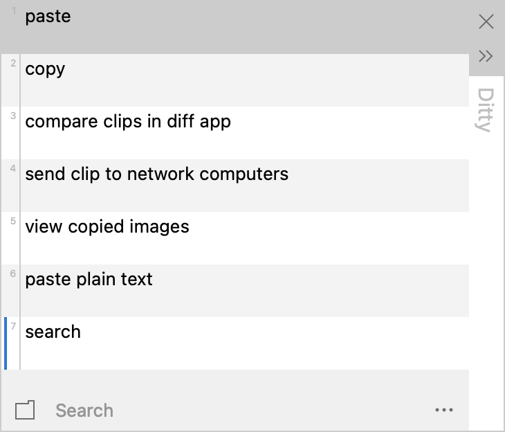

# Ditty

**The Mac version of [Ditto](https://sabrogden.github.io/Ditto/)** — an unofficial, native macOS clipboard manager that looks and works like the Windows original.



Ditty saves everything you copy and lets you paste any of it back later. Press the hotkey, pick a clip (or type to search), press Enter.

> **Status: early release.** It works for daily use on the author's Mac, but it is new. Please [open an issue](../../issues) if something breaks.

Ditty is not affiliated with or endorsed by Ditto or its author, Scott Brogden. It is a separate program written from scratch in Swift; it borrows Ditto's look, defaults and way of working because people moving from Windows keep asking for exactly that.

## Features

- Saves text, rich text, HTML, images and files copied in Finder
- Popup at the text caret (or mouse cursor) with Ditto's default look, plus a dark theme
- Search as you type, with matches highlighted
- Paste with Enter, paste as plain text with Shift+Enter, paste clips 1–10 with ⌘1–⌘0
- Paste Special: upper/lower case, capitalize, sentence case, camel case, slugify, remove line feeds, trim, and more
- Groups, sticky clips, and "never auto delete"
- Clip properties, including editing a clip's text
- Keeps the last 500 copies by default, with optional expiry in days
- Skips copies that password managers mark as confidential
- Everything stays on your Mac, in a SQLite database under `~/Library/Application Support/Ditty`

Not here yet, compared with Ditto: network sync ("Friends"), import/export (including importing a Ditto database), per-clip global hotkeys, and the clip compare tool.

## Install

1. Download **Ditty.zip** from the [latest release](https://github.com/20101997/Ditty/releases/latest) and unzip it.
2. Drag **Ditty.app** into your Applications folder and open it.
3. macOS will refuse the first time, because Ditty is not signed with a paid Apple developer certificate. Open **System Settings → Privacy & Security**, scroll down, and click **Open Anyway** next to the message about Ditty.

A 〃 icon appears in the menu bar. Ditty runs on macOS 13 or later, on both Apple Silicon and Intel Macs.

If you prefer the Terminal, this does the same as step 3:

```sh
xattr -dr com.apple.quarantine /Applications/Ditty.app
```

### Build it yourself

You need Apple's Command Line Tools (`xcode-select --install`); full Xcode is not required.

```sh
git clone https://github.com/20101997/Ditty.git
cd Ditty
./build.sh --install
```

### Let Ditty paste for you

To paste into other apps, Ditty has to press ⌘V on your behalf, and macOS only allows that with your permission: turn on **Ditty** under **System Settings → Privacy & Security → Accessibility**.

Without it, choosing a clip still puts it on the clipboard; you press ⌘V yourself.

macOS ties this permission to the exact build, so you have to turn it on again after installing a new version: remove Ditty from the list and add it back. (If you build it yourself, setting `SIGN_ID` to a signing identity when running `build.sh` avoids that.)

## Using it

| Key | What it does |
|---|---|
| `⌃` + `` ` `` | Open Ditty (change it in Options → Keyboard Shortcuts) |
| `↩` | Paste the selected clip |
| `⇧↩` | Paste as plain text |
| `⌘1` – `⌘0` | Paste clip 1 – 10 |
| `↑` `↓` | Move through the list (hold `⇧` to select several) |
| `⌘⌫` or `⌦` | Delete the selected clips |
| `⌘C` | Copy to the clipboard without pasting |
| `F3` | Show the whole clip |
| `F7` | New group |
| `⌥↩` | Clip properties |
| `⎋` | Clear the search, then close |

Right-click a clip, or click `···`, for everything else. Click the menu bar icon to open Ditty; right-click it for Options and Exit.

## License

[GPL-3.0](LICENSE), the same licence as Ditto.
